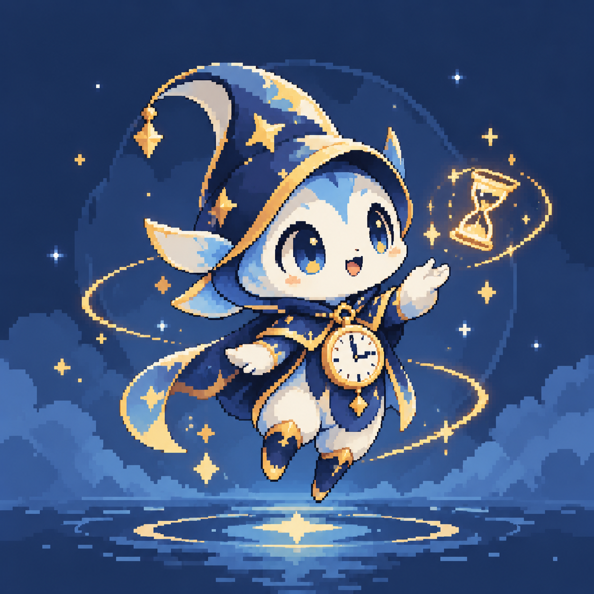
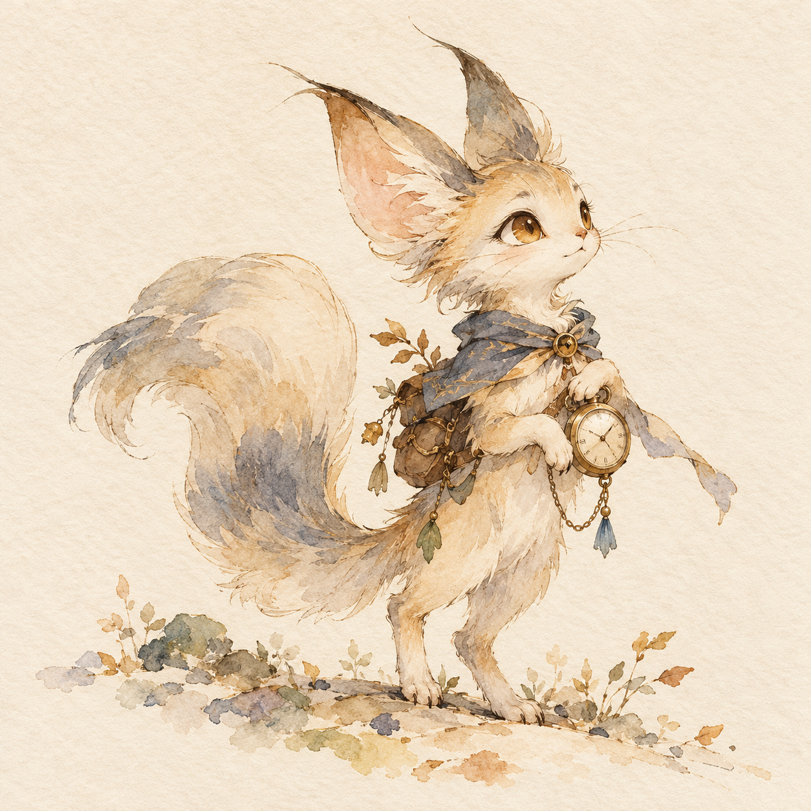
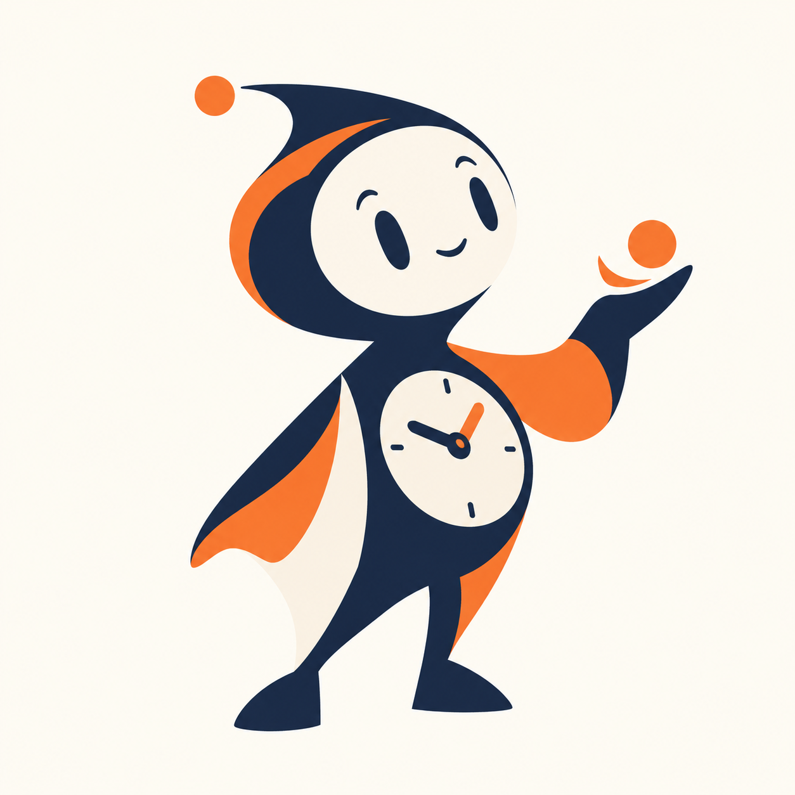
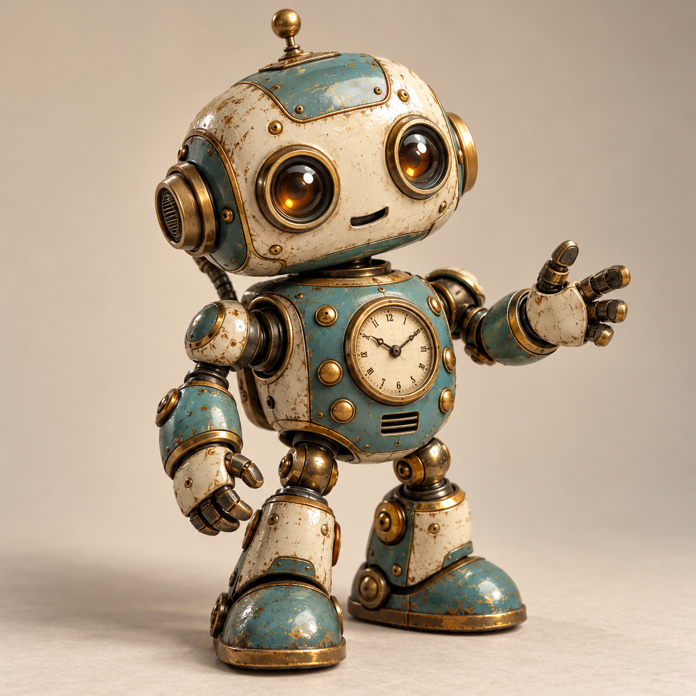
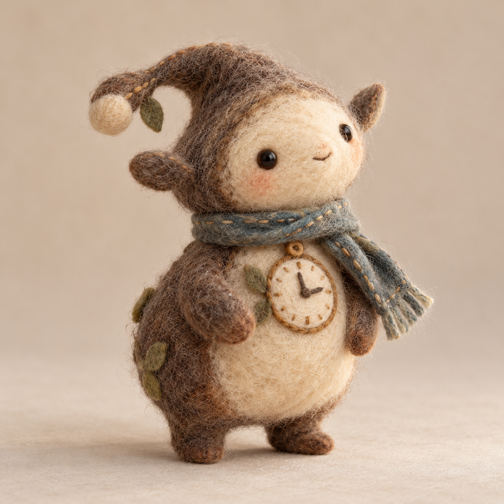

# Kairos 候选形象

使用内置 imagegen 生成的五种风格概念图，尚未选定为正式形象。已逐张检查风格、主体完整性与构图。

## pixel

生成提示词：

Create a new original Kairos personal AI companion mascot concept in authentic crisp pixel art style. A small curious time sprite with an expressive face, a tiny clock detail and friendly capable personality. Full body, iconic memorable silhouette, limited carefully chosen game palette, visible square pixels, no antialiasing, beautifully composed like a premium indie game character portrait. Square canvas, simple complementary background with generous space. One character only, no text, no watermark. Strongly pixel-art, not 3D. This is one of five distinctly styled mascot concepts.

## watercolor

生成提示词：

Create a new original Kairos personal AI companion mascot concept in delicate Japanese hand-drawn watercolor storybook style. A gentle clever little animal-like spirit carrying a small pocket watch, alert expressive eyes, a quietly helpful personality. Elegant ink contours, translucent watercolor washes, textured warm paper, poetic restrained composition, full body with generous negative space. Square canvas. One character only, no text, no watermark, no 3D rendering. Make the character charming yet not overly infantile.

## geometric

生成提示词：

Create a new original Kairos personal AI companion mascot concept in bold minimalist geometric editorial illustration style. A clever friendly abstract companion built from a few confident flat shapes, with a subtle clock or time motif organically integrated into the body and an expressive minimal face. Memorable sophisticated silhouette suitable for a software avatar, distinctive asymmetric pose, tightly restrained harmonious color palette, crisp edges, flat solid color, no gradients or texture or 3D. Full body, one character centered on a clean square background, generous space. No text, no watermark.

## retro-robot

生成提示词：

Create a new original Kairos personal AI companion mascot concept as a vintage tin toy robot, warm retro-futurist industrial design. A small friendly capable mechanical companion with rounded stamped metal forms, tactile enamel paint, gently worn brass, expressive lens eyes and a little analog clock integrated in its chest. Thoughtful original design with restrained readable details, not a recognizable existing character. Full body three-quarter studio portrait, beautiful product photography, soft shadows, simple square background, one character only, no text, no watermark.

## felt

生成提示词：

Create a new original Kairos personal AI companion mascot concept as a handmade needle-felt wool creature photographed in a miniature craft studio. A compact gentle curious creature, soft irregular silhouette, little attentive bead eyes, charming stitched clock emblem, small fabric scarf. Clearly visible wool fibers, lovingly imperfect handcraft, cozy tactile softness, sophisticated restrained colors, natural diffuse light. Full body three-quarter portrait, single character on uncluttered square backdrop with generous space. No text, no watermark. Clearly felt craft rather than smooth plastic or digital 3D.

