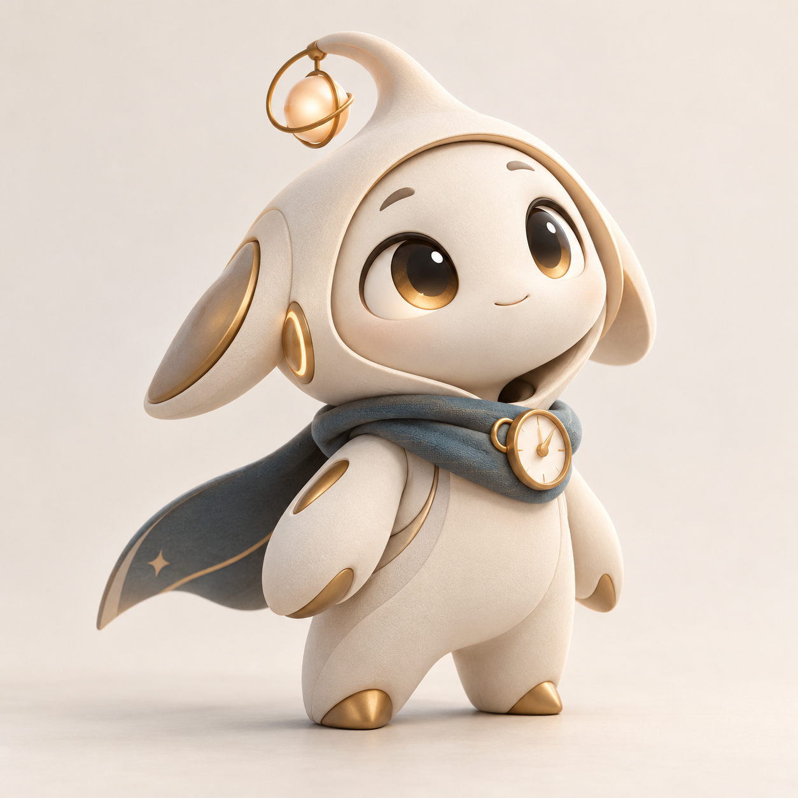

# Kairos 正式形象

唯一母版为 `kairos-master.png`，即用户选定的第一版原图。完整规则见[形象设计方案](../../../docs/形象设计方案.md)。

- [透明全身](kairos-cutout.png)
- [方形头像](kairos-avatar.png)
- [多视图参考](kairos-turnaround.png)
- [六种表情](kairos-expressions.png)
- [六种动作](kairos-actions.png)
- [生成提示词](prompts.json)
- [尺寸与文件校验清单](manifest.json)

延展图使用内置 imagegen，以母版为唯一图片参考。身份以母版为准，背面和动作属于延展参考，尚无统一三维模型或动画。透明图含真实 alpha；用于深底时需检查生成边缘。
