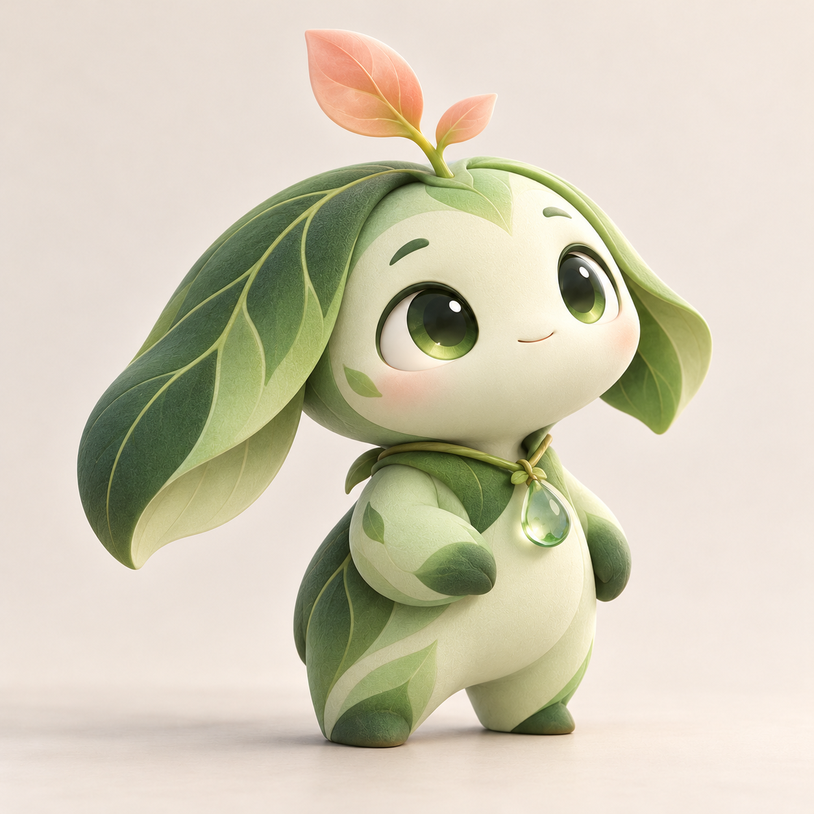
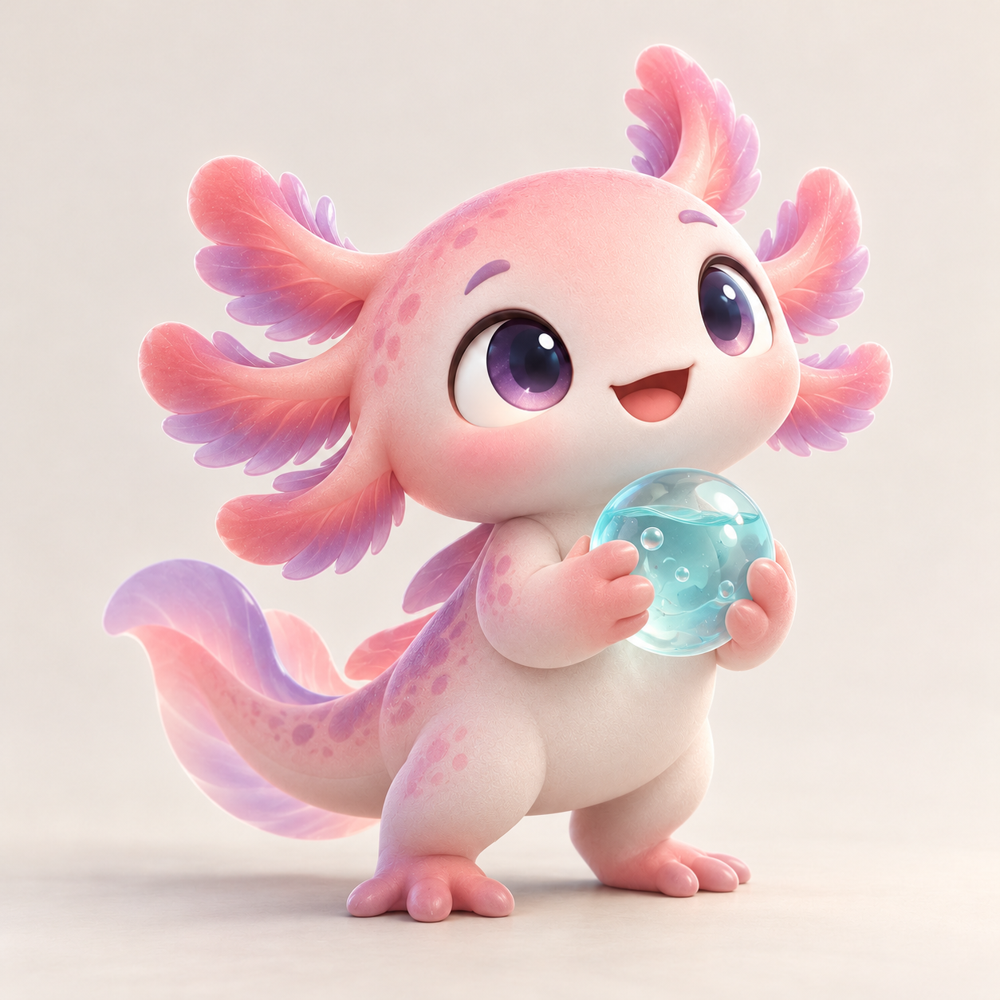
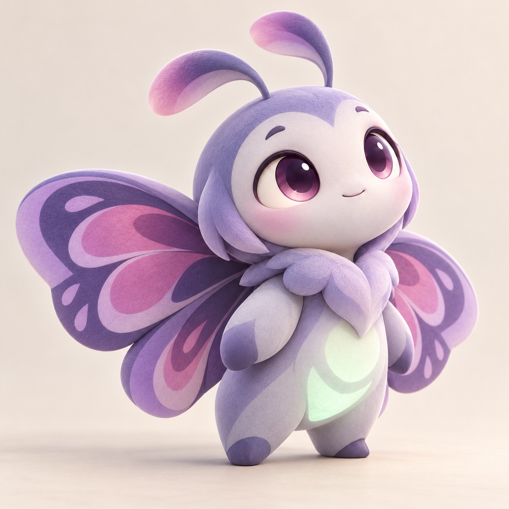
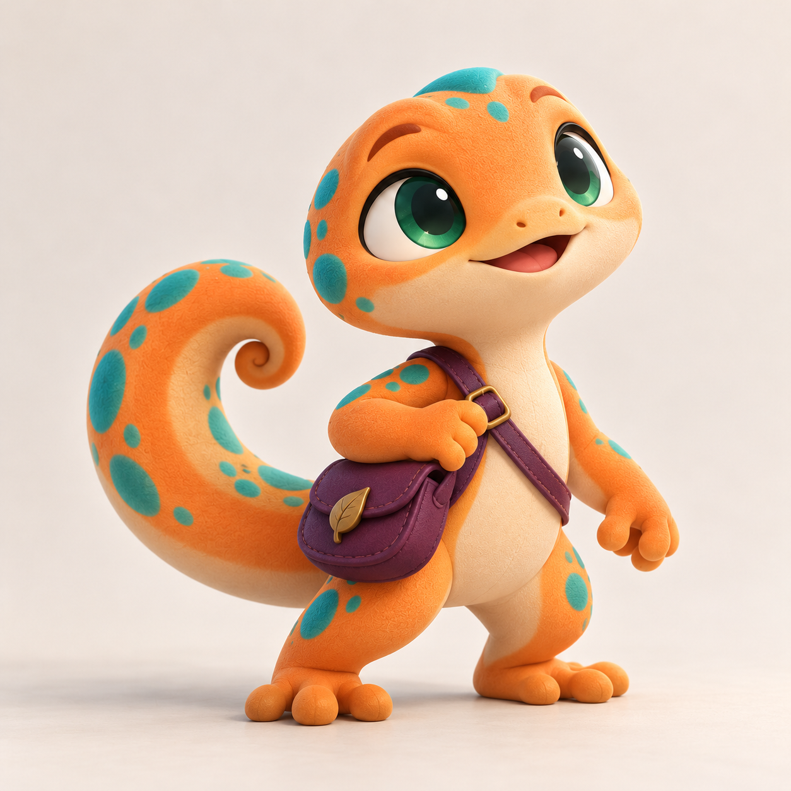
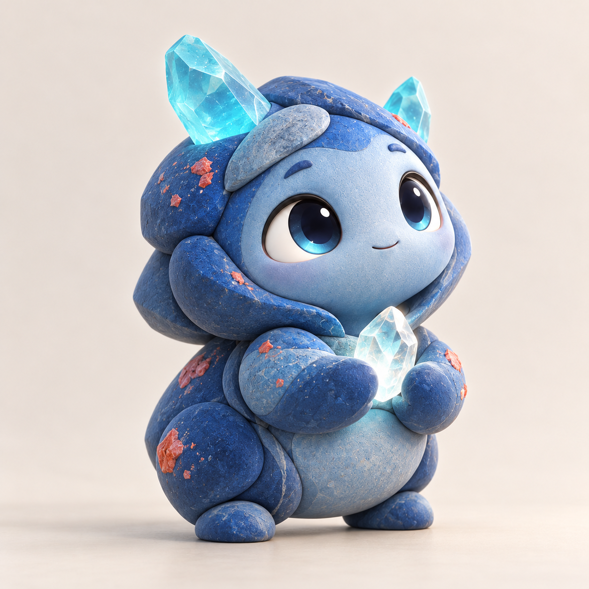

# Kairos 柔和 3D 候选形象

按用户确认的方向，仅延续第一版柔和细腻的 3D 画风；配色、角色、装饰与主题元素重新设计。使用内置 imagegen，以第一版图片为画风参考生成。五张均已检查主体、风格、配色差异与构图，尚未定稿。

## mint-sprout

生成提示词：

Create ONE new original mascot concept for Kairos. The attached image is a RENDERING STYLE reference ONLY: borrow its premium soft stylized 3D animation / collectible rendering, fine matte surface texture, appealing proportions, sophisticated studio lighting, delicate realistic contact shadows, expressive polished eyes, gentle warmth and high craftsmanship. DO NOT copy the reference character, its colors, hood, clothes, watch, gold trim, scarf, space motifs or silhouette. The user explicitly wants different colors, motifs and character designs while keeping the same rendering art style. This must look like a new design by the same studio, not a recolor. Single complete full-body character, three-quarter portrait, square composition, generous margins, simple pale neutral studio background, no text, no watermark, no extra characters or collage. No pixel art, watercolor, flat graphic or wool-felt. Character brief: A mint-green and deep forest-green little botanical creature, rounded seed-shaped body, two large asymmetric leafy ears, tiny feet, bright dark green glassy eyes. A fresh peach-pink sprout grows on its head, small translucent dew-drop pendant, subtle leaf-vein details. Friendly curious pose. Absolutely no cream/gold/blue-gray palette, scarves, clocks, planets or stars.

## coral-axolotl

生成提示词：

Create ONE new original mascot concept for Kairos. The attached image is a RENDERING STYLE reference ONLY: borrow its premium soft stylized 3D animation / collectible rendering, fine matte surface texture, appealing proportions, sophisticated studio lighting, delicate realistic contact shadows, expressive polished eyes, gentle warmth and high craftsmanship. DO NOT copy the reference character, its colors, hood, clothes, watch, gold trim, scarf, space motifs or silhouette. The user explicitly wants different colors, motifs and character designs while keeping the same rendering art style. This must look like a new design by the same studio, not a recolor. Single complete full-body character, three-quarter portrait, square composition, generous margins, simple pale neutral studio background, no text, no watermark, no extra characters or collage. No pixel art, watercolor, flat graphic or wool-felt. Character brief: A coral pink and soft lavender axolotl-inspired companion with six soft feathery gill lobes, rounded smooth body, a short curled tail, cheerful expressive violet eyes, little webbed feet. A small translucent aqua bubble held gently in its hands. Playful ocean explorer character. Absolutely no ivory/gold palette, scarves, clocks, planets or stars.

## violet-moth

生成提示词：

Create ONE new original mascot concept for Kairos. The attached image is a RENDERING STYLE reference ONLY: borrow its premium soft stylized 3D animation / collectible rendering, fine matte surface texture, appealing proportions, sophisticated studio lighting, delicate realistic contact shadows, expressive polished eyes, gentle warmth and high craftsmanship. DO NOT copy the reference character, its colors, hood, clothes, watch, gold trim, scarf, space motifs or silhouette. The user explicitly wants different colors, motifs and character designs while keeping the same rendering art style. This must look like a new design by the same studio, not a recolor. Single complete full-body character, three-quarter portrait, square composition, generous margins, simple pale neutral studio background, no text, no watermark, no extra characters or collage. No pixel art, watercolor, flat graphic or wool-felt. Character brief: A twilight violet and periwinkle little moth spirit with rounded compact body, two short softly curved antennae, broad beautifully simplified wings with pale lilac and magenta petal-shaped markings, large luminous plum eyes. Small pale mint glowing abdominal accent. Dreamy curious expression, wings partly open. No cream/gold palette, scarves, clocks, celestial ornaments or mechanical elements.

## tangerine-gecko

生成提示词：

Create ONE new original mascot concept for Kairos. The attached image is a RENDERING STYLE reference ONLY: borrow its premium soft stylized 3D animation / collectible rendering, fine matte surface texture, appealing proportions, sophisticated studio lighting, delicate realistic contact shadows, expressive polished eyes, gentle warmth and high craftsmanship. DO NOT copy the reference character, its colors, hood, clothes, watch, gold trim, scarf, space motifs or silhouette. The user explicitly wants different colors, motifs and character designs while keeping the same rendering art style. This must look like a new design by the same studio, not a recolor. Single complete full-body character, three-quarter portrait, square composition, generous margins, simple pale neutral studio background, no text, no watermark, no extra characters or collage. No pixel art, watercolor, flat graphic or wool-felt. Character brief: A tangerine-orange and teal little gecko companion with a broad rounded head, friendly emerald eyes, small rounded fingers, and a large curled tail with turquoise spots. Wears a tiny plum-purple cross-body utility satchel with a simple leaf-shaped clasp; looks energetic and resourceful. Cute premium sculpted figure with soft tactile surfaces. No cream/gold palette, scarves, clocks, stars or planets.

## cobalt-pebble

生成提示词：

Create ONE new original mascot concept for Kairos. The attached image is a RENDERING STYLE reference ONLY: borrow its premium soft stylized 3D animation / collectible rendering, fine matte surface texture, appealing proportions, sophisticated studio lighting, delicate realistic contact shadows, expressive polished eyes, gentle warmth and high craftsmanship. DO NOT copy the reference character, its colors, hood, clothes, watch, gold trim, scarf, space motifs or silhouette. The user explicitly wants different colors, motifs and character designs while keeping the same rendering art style. This must look like a new design by the same studio, not a recolor. Single complete full-body character, three-quarter portrait, square composition, generous margins, simple pale neutral studio background, no text, no watermark, no extra characters or collage. No pixel art, watercolor, flat graphic or wool-felt. Character brief: A cobalt-blue and turquoise small pebble spirit companion with a squat softly rounded body, four tiny rounded feet, two small uneven crystal-like translucent cyan horns, luminous attentive dark eyes, and a smooth face framed by layered rounded rock shapes. Small coral-red mineral flecks on its body and a tiny clear glowing crystal held in its little hands. Calm dependable personality. No cream/gold palette, scarves, clocks, planets, stars or animal costumes.

